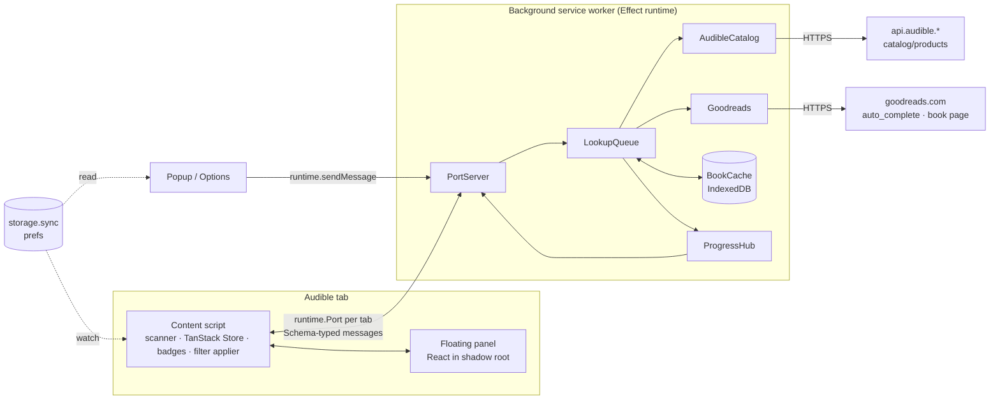

# Architecture — audible-ex

Status: design, 2026-10-29. Replaces the earlier architecture draft. Decisions are in
[DECISIONS.md](DECISIONS.md); the delivery plan is in
[PLAN.md](PLAN.md).

The behaviour we start from is the userscript in
[`reference/audible-goodreads-ratings.user.js`](../reference/audible-goodreads-ratings.user.js) (v2.4.0).
It already solves card detection, Goodreads matching, caching and badge placement, and it works
today. The extension ports that logic and adds a floating panel, progress tracking and persistent
filters. When this document and the userscript disagree about _how Audible or Goodreads behave_,
the userscript is the tested reference.

## 1. Goals and non-goals

Goals

- Goodreads rating, rating count, first-published year, top genres and an overview on hover, on
  every Audible card (search, category, deals, home daily deal, library, collections, wish list).
- A floating panel on Audible pages: progress of the Goodreads loader, filter controls, show/hide.
- Filters that reflect personal preference and persist: minimum rating (default 4.0), minimum
  number of ratings, hidden labels, later price and year.
- All 10 Audible marketplaces the userscript supports (`.co.uk .com .ca .com.au .de .fr .it .es
.in .co.jp`). Matching quality is best for English titles; other languages are best effort.
- Publishable on the Chrome Web Store (see §11). Firefox is a later target; WXT keeps that cheap.

Non-goals (for now)

- No server of our own, no accounts, no analytics. Everything runs in the user's browser.
- No bundled or exported rating dataset.
- No other rating sources in v1 (Hardcover is the planned second source, see PLAN.md).

## 2. Stack

| Tool                                       | Role                                                                                                                                                   | Notes                                                                                                                                                                     |
| ------------------------------------------ | ------------------------------------------------------------------------------------------------------------------------------------------------------ | ------------------------------------------------------------------------------------------------------------------------------------------------------------------------- |
| **Bun** 1.4                                | Package manager, script runner, test runner (`bun test`)                                                                                               | WXT 0.21 declares `bun >= 1.2`; `bun --bun wxt build` was verified to build on the Bun runtime. Bun runs package scripts by name, so `bun check` runs the `check` script. |
| **WXT** 0.21                               | Extension framework: manifest generation, entrypoints, HMR, zip/publish, `storage`, shadow-root UI                                                     | Configured with `imports: false` (no auto-imports) so the same modules load under `bun test`.                                                                             |
| **Vite** 8                                 | Bundler, through WXT                                                                                                                                   | No separate Vite config; plugins (React, Tailwind) go through `wxt.config.ts`.                                                                                            |
| **Effect** 4.1                             | Background worker: services and layers, HTTP client, schemas, concurrency, retries/backoff, request batching, typed errors. Schemas shared everywhere. | The content script uses only `effect/Schema` (see §6 on bundle size).                                                                                                     |
| **TanStack Store**                         | UI-facing state in the content script (books, progress, filter verdicts), read from React with `@tanstack/react-store`                                 | Framework-agnostic, so the non-React parts (badges, filter applier) subscribe to it too.                                                                                  |
| **TanStack Pacer**                         | UI-side timing: debounce the rating slider, batch MutationObserver rescans                                                                             | Background rate limiting stays in Effect so it shares the retry/backoff model.                                                                                            |
| **TanStack Form**                          | Options page settings form                                                                                                                             | The floating panel's controls are live (no submit), so they don't use Form.                                                                                               |
| **TanStack Table + Virtual**               | Options page cache inspector (phase 4)                                                                                                                 | Thousands of cached books, sortable.                                                                                                                                      |
| **React 19**, **Tailwind 4**, **Radix UI** | Panel, popup, options UI                                                                                                                               | TanStack has no component library; Radix (Slider, Switch, Popover, Tooltip) provides accessible primitives, styled shadcn-style.                                          |
| **TypeScript** 7                           | Type checking (`effect-tsgo tsc --noEmit`)                                                                                                             | Bun strips types but doesn't check them. `@effect/tsgo` adds Effect diagnostics to the same run (DECISIONS.md D14).                                                       |
| **Biome**                                  | Lint and format (`biome ci`)                                                                                                                           | Replaces ESLint + Prettier (DECISIONS.md D4); its `noRestrictedImports` rule enforces the Effect import rule (§6).                                                        |
| **Playwright**                             | End-to-end smoke tests with the built extension loaded                                                                                                 | Already a dependency.                                                                                                                                                     |

Removed from the current scaffold, and why:

| Removed                                        | Replaced by                                        | Reason                                                                                                                                                                     |
| ---------------------------------------------- | -------------------------------------------------- | -------------------------------------------------------------------------------------------------------------------------------------------------------------------------- |
| Vitest, `@vitest/*`, jsdom, `vitest.config.ts` | `bun test` + happy-dom + WXT's fake browser        | Verified: `wxt/utils/storage` on `wxt/testing/fake-browser`, happy-dom DOM tests and Effect's `TestClock` all run under `bun test`.                                        |
| Zustand stores (`src/stores/*`)                | WXT `storage` items + TanStack Store               | The stores persisted to `localStorage`, which in a content script is the Audible site's own storage: per region, wiped with site data, unreadable by popup and background. |
| TanStack Query (`src/lib/query-client.ts`)     | Effect in the background, push updates over a port | Data is pushed by the background as it arrives; fetching, deduping, caching and retrying happen in Effect. A second cache layer in the UI would duplicate that.            |
| `DomainDetector` singleton                     | Pure `regionFromHost()` + a config table           | Nothing to cache or instantiate; easier to test.                                                                                                                           |
| ESLint, Prettier and their configs             | Biome                                              | One faster tool, as in the owner's other repositories (DECISIONS.md D4).                                                                                                   |
| `package-lock.json`                            | `bun.lock`                                         |                                                                                                                                                                            |

Considered and not used yet: TanStack Router (options page has a few tabs, not routes), TanStack DB,
Effect `Atom` (overlaps with TanStack Store), Effect RPC (a typed-message protocol over a port is
enough for now; revisit if the protocol grows streaming requests).

## 3. Runtime topology



- **Background** owns all network access and the cache. One queue serves every tab, so two open
  Audible tabs don't double the Goodreads traffic (the userscript ran one queue per tab).
- **Content script** finds cards, asks for the ASINs that scroll into view, renders badges, applies
  filters and mounts the panel.
- **Popup / options** read prefs from storage and ask the background for cache stats and clearing.

## 4. Background worker (Effect)

The worker builds one `ManagedRuntime` from the layer graph at start-up and runs the port server
on it. Each service is a `Context` service with a live layer and a test layer.

| Service          | Responsibility                                                                                                                                                                                                                                                                                                                    | Ported from (userscript)                                   |
| ---------------- | --------------------------------------------------------------------------------------------------------------------------------------------------------------------------------------------------------------------------------------------------------------------------------------------------------------------------------- | ---------------------------------------------------------- |
| `Http`           | `FetchHttpClient` layer. Requests to Goodreads use `credentials: 'omit'` so lookups aren't tied to the user's Goodreads account.                                                                                                                                                                                                  | `get()`                                                    |
| `AudibleCatalog` | `title`, first `author` (and later price) for an ASIN. Uses `Request`/`RequestResolver` so concurrent lookups batch into one `catalog/products?asins=…` call of up to 40.                                                                                                                                                         | `getMeta`, `flushMeta`                                     |
| `Goodreads`      | `search(meta)` via `book/auto_complete` and the scoring rules; `details(bookId)` from the book page's `__NEXT_DATA__` (genres, overview, first-published year). Responses are decoded with Schemas; a decode failure is a `FormatChanged` error, not a miss.                                                                      | `searchGoodreads`, `fetchDetails`                          |
| `BookCache`      | IndexedDB stores `ratings` (by ASIN), `meta` (by ASIN), `details` (by Goodreads id), `pins` (ASIN → last seen). Time limits: hit 30 days, miss 7 days. Daily purge of unpinned entries older than 32 days; pins expire 180 days after last seen in Library/Wish List.                                                             | `cacheGet/Set`, `pin`, `purge`                             |
| `LookupQueue`    | Dedupes in-flight work per ASIN and Goodreads id, runs jobs with a 3-permit `Semaphore` and a 250 ms gap per worker, two priorities (visible > background upgrades). On 429/503 the whole queue pauses with exponential backoff (5 s → 2 min, honouring `Retry-After`); a `CircuitBreaker` stops traffic after repeated failures. | `grQueued`, `pumpGr`, `ratingFor`, `detailsFor`, `addYear` |
| `ProgressHub`    | Per-tab counters (queued, active, done, cached, not found, failed, paused-until), published with `PubSub` to the tab's port.                                                                                                                                                                                                      | — (new)                                                    |
| `PortServer`     | Accepts `runtime.connect` from content scripts, decodes messages, routes to the queue, encodes updates back. Handles one-off popup messages.                                                                                                                                                                                      | — (new)                                                    |

Pure logic stays outside Effect, in `src/core/` (title normalisation, author/title scoring, filter
verdicts, region table). The services call it; tests hit it directly with fixtures.

Errors are tagged: `HttpError(status)`, `RateLimited(retryAfter)`, `FormatChanged(source)`,
`NoMetadata(asin)`. "Not found on Goodreads" is a normal result (`{ miss: true }`), cached for 7
days. Failures are not cached; the content script can retry them. `FormatChanged` is reported
separately in the panel ("Goodreads changed its page format — the extension needs an update") so it
isn't confused with network trouble.

Two behaviours found in the phase 0 spike (issue #21). Goodreads answered a book-page request
once with `202` and an empty body, which looks like a bot or rate challenge; treat `202` and an
empty body as a rate-limit signal that pauses the queue like `429`, not as `FormatChanged`.
`catalog/products` answers `200` with a bare `{ "asin": … }` for an ASIN the marketplace doesn't
carry (an ASIN from `.com` queried on `.ca` has no title), so `AudibleCatalog` queries the API host
of the page's own marketplace and maps a product without a title to `NoMetadata`.

**Service worker lifetime.** MV3 stops an idle worker after ~30 s. An open port with traffic keeps it
alive while a page is loading. If the worker restarts anyway, in-flight work is lost; the content
script reconnects (port `onDisconnect`) and re-sends every ASIN that hasn't resolved. The cache
makes that cheap. Verified in the spike: after the worker was stopped, the port disconnected, the
content script's `onDisconnect` reconnect reached a new `ManagedRuntime` within 100 ms, and it
answered the re-sent `Hello`. Not yet verified: the natural ~30 s idle stop (a debugger attached
through CDP keeps the worker alive), so check it in a normal browser in phase 1.

## 5. Messaging

One long-lived `runtime.Port` per tab, named `agx`. Every message is an Effect Schema tagged union,
decoded on receipt in both directions.

Content → background

| Message  | Fields                                                           |
| -------- | ---------------------------------------------------------------- |
| `Hello`  | `region`, `page` (search, library, wishlist, …)                  |
| `Lookup` | `items: { asin, pinned }[]` — `pinned` on library/wish list rows |
| `Retry`  | `asins`                                                          |

Background → content

| Message      | Fields                                                                                       |
| ------------ | -------------------------------------------------------------------------------------------- |
| `BookUpdate` | `asin`, `status` (`loading`, `ready`, `notFound`, `failed`), `rating?`, `details?`, `error?` |
| `Progress`   | per-tab counters and `pausedUntil?`                                                          |

Popup / options → background (one-off `sendMessage`): `CacheStats`, `ClearCache { scope: 'unpinned' | 'all' }`.
These replace the userscript's `GM_registerMenuCommand` entries.

## 6. Content script

```
scan (MutationObserver, batched with Pacer)
  → card + ASIN (ported cardFor / asinOf / findTitleEl)
  → IntersectionObserver (400 px margin)
  → Lookup over the port
BookUpdate → TanStack Store (books) → badges + filter applier + panel
```

**Scanner and cards.** Ported as-is: card detection by "largest ancestor linking only to this
ASIN", known row selectors for library and list pages, observer cleanup. Cards are DOM elements, so
they stay out of the reactive store: a `WeakMap<Element, asin>` and a `Map<asin, Set<Element>>`.

**Book store (TanStack Store).**

```ts
type BookView = {
  status: 'queued' | 'loading' | 'ready' | 'notFound' | 'failed'
  rating?: { r: number; n: number; url: string; loose: boolean }
  details?: { genres: string[]; year: number; desc: string }
  price?: { amount: number; currency: string }
}
type ContentState = {
  books: Map<string, BookView>
  progress: Progress
  prefs: Prefs
  peek: boolean
}
```

**Badges.** Plain DOM, not React. Badges must sit inside Audible's own markup, there can be
hundreds, and the userscript's placement code already handles Audible's layouts. Classes use an
`agx-` prefix; the small stylesheet is imported as a string (`?inline`) and injected once.

**Filter applier.** A derived store computes a verdict per ASIN, `show | dim | hide`, from
`books` and `prefs` (§7). A subscriber writes it to `data-agx-filter` on each card, and CSS does the
rest (`[data-agx-filter=hide]{display:none!important}`). Removing a filter only removes an
attribute; nothing is torn down and rebuilt.

**Floating panel.** React mounted with WXT's `createShadowRootUi` (`cssInjectionMode: 'ui'`), so
Tailwind and Audible's CSS can't affect each other. The hover overview renders inside the same
shadow root (`position: fixed`), which isolates it from page styles too.

- Shell: drag to a corner, collapse to a pill (rating icon + `34/60`), hide for this site. Hidden
  state is restored from the popup.
- Progress: bar plus `34/60 · 18 cached · 2 not found · 1 failed`; "Paused — Goodreads is rate
  limiting (12 s)"; "Retry failed".
- Filters: rating slider, minimum ratings, hidden-labels picker (autocomplete from genres seen in
  the cache), "not found" policy, dim/hide mode, master on/off.
- Counter: `12 hidden · Show` — **Show** toggles `peek`, which reveals hidden cards (dimmed)
  without changing preferences.

**Effect in the content script.** Only `effect/Schema`, for the message codecs. The content script
runs on every Audible page, so it stays lean; the concurrency and error handling Effect is good at
live in the background. Import Effect modules by path (`effect/Schema`), never from the `effect`
barrel: measured with Bun's bundler, a Schema-only module was 23 KB gzipped via `effect/Schema` and
97 KB via `effect`. A Biome rule enforces this in the content script, the UI and the modules they
share (`src/schema`, `src/storage`).

## 7. Filters

Verdict for one card (pure function in `src/core/filter.ts`):

1. Filters off, or `peek` on → `show` (hidden cards render dimmed while peeking).
2. Book not loaded yet (`queued`/`loading`/`failed`) → `show`. Hiding before data arrives makes the
   page jump.
3. `notFound` → the `notFound` policy (default `show`).
4. Rating below `minRating`, or count below `minRatings`, or any genre in `hiddenLabels`
   (case-insensitive) → the miss mode (`hide` by default, `dim` as an option).
5. Price above `maxPrice[region]` (phase 3b) → the miss mode.
6. Otherwise `show`.

Cards inside carousels and sliders get `dim` instead of `hide`; removing slides breaks Audible's
carousel layout. Which containers count as carousels is settled with fixtures during phase 3.

Label filtering needs genres, which come from the Goodreads book page (~400 KB), not the cheap
autocomplete call. Details are fetched for every visible book by default (they also drive the labels
under each badge), at lower priority than ratings. Until a book's details arrive, a hidden-label
filter can't apply to it and the card stays visible.

## 8. State and persistence

| Data                                                   | Where                                                                              | Why                                                                                                |
| ------------------------------------------------------ | ---------------------------------------------------------------------------------- | -------------------------------------------------------------------------------------------------- |
| Preferences: enabled, filters, display options         | `storage.sync` via WXT `storage.defineItem('sync:prefs', { version, migrations })` | Personal preference; follows the user across devices and Audible regions. Well within sync quotas. |
| Panel placement, collapsed state, hidden-on-site flags | `storage.local`                                                                    | Specific to this screen and device.                                                                |
| Cache: ratings, meta, details, pins                    | IndexedDB in the background, through `idb` (DECISIONS.md D13)                      | Thousands of records; needs an index on timestamp for purging. `unlimitedStorage` permission.      |
| Peek, progress, book views                             | Memory (TanStack Store)                                                            | Per page.                                                                                          |

Every reader (content scripts, popup, options) watches `sync:prefs`, so a change in one tab applies
everywhere at once. Prefs are decoded with an Effect Schema that supplies defaults, so a missing or
older field never crashes the UI.

```ts
// Prefs v1, defaults shown
{
  enabled: true,
  filters: {
    enabled: true,
    minRating: 4.0,          // slider 3.0–5.0, step 0.1
    minRatings: 50,          // 0 turns it off
    hiddenLabels: [],        // Goodreads genre names
    notFound: 'show',        // 'show' | 'dim' | 'hide'
    mode: 'hide',            // 'hide' | 'dim'
    maxPrice: {},            // per region, phase 3b
  },
  display: { labels: 3, year: true, overview: true },
}
```

The cache is keyed by ASIN and by Goodreads book id, not by region: ASINs are unique across
marketplaces, and the same Goodreads book seen from two regions shares one details entry. The
same title can have a different ASIN on each marketplace (Project Hail Mary is `B08G9PRS1K` on
`.com` and `B08GBHW6J1` on `.ca`), so a book seen on two marketplaces is two `ratings` entries
that share one `details` entry.

## 9. Regions

`src/core/regions.ts` maps hostname → region code, Audible API host (`www.` → `api.`), currency and
locale. The 10 marketplaces match the userscript's `@match` list. The content script's `matches` and
the manifest's host permissions are generated from the same table, so they can't drift apart.

Price, when added, comes from the Audible catalog API rather than from page text. Whether
`catalog/products` returns price without signing in (via a price response group) is unverified; it
is the first task of phase 3b, with page-text parsing as the fallback.

## 10. Testing

| Layer               | Tool                                           | What                                                                                                                                   |
| ------------------- | ---------------------------------------------- | -------------------------------------------------------------------------------------------------------------------------------------- |
| Pure logic          | `bun test`                                     | Matching (with real autocomplete fixtures), filter verdicts, region table, Schemas.                                                    |
| Background services | `bun test` + test layers                       | Fake `HttpClient` returning recorded fixtures; `TestClock` for cache expiry, backoff and the request gap; queue dedupe and priorities. |
| Content script DOM  | `bun test` + happy-dom                         | Card detection and badge placement against saved Audible page HTML for each page type.                                                 |
| React UI            | `bun test` + Testing Library                   | Panel states, filter controls, peek.                                                                                                   |
| Storage             | `bun test` + `wxt/testing/fake-browser`        | Prefs defaults, migrations, watch.                                                                                                     |
| End to end          | Playwright, built extension loaded in Chromium | Smoke test on live Audible pages; run manually and before releases, not on every push (live sites change).                             |

`test/preload.ts` (set in `bunfig.toml`) registers happy-dom and sets `globalThis.browser` and
`chrome` to WXT's fake browser. `@wxt-dev/storage` reads `browser` from `@wxt-dev/browser`, so mocking
only `wxt/browser` isn't enough; the global is what works (verified).

Fixtures live in `test/fixtures/{audible,goodreads}/` and are refreshed with
`bun scripts/capture-fixtures.ts` when a site changes. A failing fixture test after refreshing is
how we detect that Audible or Goodreads changed their pages. The script goes through the same
courtesy rules as the extension (one request at a time, a pause, no cookies, back off on 429/503 and then stop) and
never runs in CI. Pages are stored cleaned: no scripts, tokens, request ids, session values or
reviewer data. Library and wish list need a signed-in browser, so they are saved by hand and cleaned
by `capture-fixtures.ts import`. What each fixture is, and the steps, are in
`test/fixtures/README.md`.

## 11. Manifest, permissions, privacy

- `permissions`: `storage`, `unlimitedStorage`.
- `host_permissions`: `https://www.goodreads.com/*` and the 10 `https://api.audible.<tld>/*` hosts.
  Background fetches need these to get past CORS.
- Content script `matches`: the 10 `https://www.audible.<tld>/*` sites; `all_frames: false`.
- No `tabs`, `scripting` or `<all_urls>`. The port's `sender.tab.id` identifies the tab.
- No remote code; everything is bundled.

Privacy. The extension reads Audible page content, including Library and Wish List, and sends book
titles and authors to Goodreads to look up ratings. Nothing else leaves the browser: no analytics, no
server, no account. The store listing's privacy disclosures and the privacy policy say exactly that.

Publishing constraints that shape the code:

- Every badge links to the Goodreads page it came from.
- The overview is capped at 600 characters, kept only as long as the cache entry, and never
  exported.
- Name and icons don't use Audible, Amazon or Goodreads logos or trade dress. The listing and the
  options page carry "Not affiliated with Audible, Amazon or Goodreads."
- Conservative request rate and caching, as in §4.

## 12. Project layout

WXT `srcDir: 'src'`, so entrypoints live under `src/entrypoints` and the `@/` alias means `src/`.

```
src/
  entrypoints/
    background.ts            # builds the ManagedRuntime, starts PortServer
    content/index.ts         # scanner, store, badges, filter applier, mounts the panel
    popup/                   # enable toggle, show panel, cache stats/clear
    options/                 # settings (TanStack Form), cache inspector (Table + Virtual)
  core/                      # pure TS, no DOM, no Effect: text.ts, matching.ts, filter.ts, regions.ts, asin.ts
  schema/                    # Effect Schemas: messages.ts, prefs.ts, goodreads.ts, audible.ts, cache.ts
  background/                # Effect services: Goodreads.ts, AudibleCatalog.ts, BookCache.ts,
                             #   LookupQueue.ts, ProgressHub.ts, PortServer.ts, layers.ts
  content/                   # scanner.ts, cards.ts, badges.ts, store.ts, filter-applier.ts,
                             #   port-client.ts, badges.css
  ui/                        # React: panel/, components/ (Radix-based), hooks/
  storage/                   # WXT storage item definitions
  assets/                    # brand/ logo sources; icon.png (Conductor's repository icon)
  public/                    # icon/ PNGs, copied into the build as-is
test/
  preload.ts
  fixtures/{audible,goodreads}/
scripts/
  capture-fixtures.ts
reference/
  audible-goodreads-ratings.user.js
```

## 13. Commands

| Command         | Runs                                                                    |
| --------------- | ----------------------------------------------------------------------- |
| `bun install`   | Install; `postinstall` runs `wxt prepare`                               |
| `bun dev`       | `wxt` (Chrome, hot reload); `bun dev:firefox` for Firefox               |
| `bun run build` | `wxt build` (`bun build` is Bun's own bundler, so this one needs `run`) |
| `bun zip`       | `wxt zip`, the store upload                                             |
| `bun test`      | Unit and component tests                                                |
| `bun typecheck` | `wxt prepare && effect-tsgo tsc --noEmit`                              |
| `bun check`     | `biome ci` → `bun typecheck` → `bun test`; what CI runs                 |
| `bun e2e`       | Playwright smoke test against a fresh build                             |

Bun and Node versions are pinned in `mise.toml` (Node stays as a fallback runtime for WXT/Vite); CI
installs from the same file with `jdx/mise-action`. CI's shape is in PLAN.md, phase 0.
