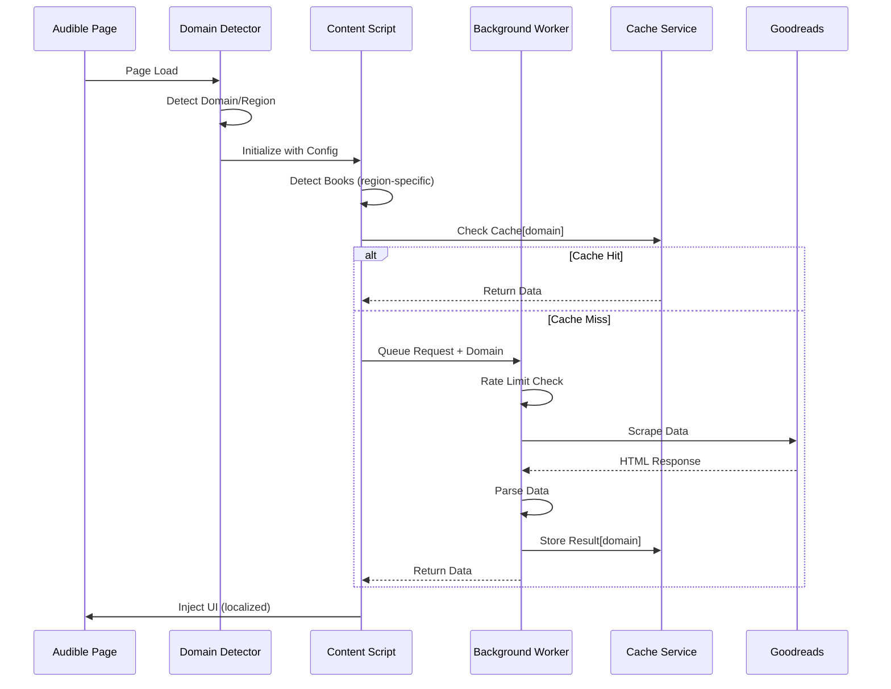

# Technical Architecture - audible-ex

## Overview

audible-ex is a Chrome extension built with modern web technologies that enhances Audible with external rating data and advanced filtering capabilities. The architecture prioritizes performance, maintainability, and user privacy through client-side processing and intelligent caching. The system supports multiple Audible domains with region-specific configurations.

## Technology Stack

### Core Framework

- **WXT** - Modern Chrome extension framework with Vite
- **React 18** - UI component library
- **TypeScript 5.x** - Type safety and better DX

### State Management

- **Zustand** - Lightweight state management
- **TanStack Query** - Data fetching and caching
- **Chrome Storage API** - Persistent settings

### UI Components

- **Shadcn/ui** - Accessible, customizable components
- **Radix UI** - Unstyled, accessible primitives
- **Tailwind CSS** - Utility-first styling

### Build Tools

- **Vite** - Fast build tool
- **ESLint** - Code linting
- **Prettier** - Code formatting

## Architecture Layers

```
┌─────────────────────────────────────────────┐
│           Content Scripts                    │
│  (DOM manipulation, event listeners)         │
├─────────────────────────────────────────────┤
│           React Components                   │
│  (UI overlay, filters, settings)             │
├─────────────────────────────────────────────┤
│           Domain Abstraction Layer           │
│  (Region-specific selectors, configs)        │
├─────────────────────────────────────────────┤
│           Service Layer                      │
│  (Scraping, caching, filtering logic)        │
├─────────────────────────────────────────────┤
│           Storage Layer                      │
│  (Chrome Storage, IndexedDB)                 │
├─────────────────────────────────────────────┤
│           Background Service Worker          │
│  (Rate limiting, queue management)           │
└─────────────────────────────────────────────┘
```

## Key Components

### 1. Content Scripts

**Location**: `entrypoints/content/`

- **AudibleEnhancer**: Main orchestrator
- **BookDetector**: Identifies books on page
- **DOMInjector**: Injects rating UI elements
- **PageRouter**: Handles different Audible pages
- **DomainDetector**: Identifies current Audible region

### 2. Domain Abstraction Layer

**Location**: `src/domains/`

```typescript
interface DomainConfig {
  domain: string
  region: 'UK' | 'US' | 'CA' | 'AU' | 'IN'
  selectors: {
    bookTitle: string
    bookAuthor: string
    bookASIN: string
    bookPrice: string
    bookCover: string
    listContainer: string
    gridContainer: string
  }
  currency: string
  dateFormat: string
  features: {
    plusCatalog: boolean
    whispersync: boolean
    sales: boolean
  }
}

// Domain configurations
const DOMAIN_CONFIGS: Map<string, DomainConfig> = new Map([
  [
    'audible.co.uk',
    {
      /* UK config */
    },
  ],
  [
    'audible.com',
    {
      /* US config */
    },
  ],
  [
    'audible.ca',
    {
      /* Canada config */
    },
  ],
  [
    'audible.com.au',
    {
      /* Australia config */
    },
  ],
  [
    'audible.in',
    {
      /* India config */
    },
  ],
])
```

### 3. Service Layer

**Location**: `src/services/`

- **RatingService**: Coordinates data fetching
- **GoodreadsScraper**: Scrapes Goodreads data
- **AlternativeSourceService**: Handles StoryGraph, Hardcover, Kaguya
- **CacheService**: Manages local storage with region separation
- **QueueService**: Handles batch processing
- **LocalizationService**: Manages multi-region support

### 4. Background Service Worker

**Location**: `entrypoints/background.ts`

- **RateLimiter**: Enforces request limits
- **RequestQueue**: Sequential processing
- **ErrorHandler**: Retry logic with backoff
- **DomainRouter**: Routes requests based on active domain

### 5. React Components

**Location**: `src/components/`

```typescript
// Component structure
components/
├── overlay/
│   ├── RatingBadge.tsx
│   ├── RatingTooltip.tsx
│   └── TagList.tsx
├── filters/
│   ├── FilterPanel.tsx
│   ├── RatingSlider.tsx
│   └── TagSelector.tsx
├── settings/
│   ├── SettingsPanel.tsx
│   ├── DomainSettings.tsx
│   └── CacheManager.tsx
└── common/
    ├── LocaleProvider.tsx
    └── CurrencyDisplay.tsx
```

### 6. Storage Architecture

**Location**: `src/storage/`

```typescript
interface StorageSchema {
  // Chrome Sync Storage (5KB limit)
  globalSettings: {
    defaultMinRating: number
    defaultMinRatingCount: number
    ratingSource: 'goodreads' | 'storygraph' | 'hardcover'
    highlightThreshold: number
  }

  // Chrome Local Storage (10MB limit)
  domainSettings: Map<
    string,
    {
      minRating: number
      minRatingCount: number
      activeTags: string[]
      enabled: boolean
    }
  >

  cache: {
    // Separate cache per domain
    'audible.co.uk': Map<string, BookData>
    'audible.com': Map<string, BookData>
    'audible.ca': Map<string, BookData>
    // ... other domains
    lastCleanup: Date
  }

  // IndexedDB (if needed for larger data)
  profiles?: {
    imported: UserProfile[]
    tasteMaps: TasteProfile[]
  }
}
```

## Cache System

### Cache Strategy

- **Storage Type**: Chrome Local Storage + IndexedDB fallback
- **Cache Size**: 1000 books per domain (configurable)
- **Eviction Policy**: LRU (Least Recently Used)
- **TTL**: 7 days per entry
- **Key Format**: `${domain}_${isbn13}` or `${domain}_asin_${asin}`
- **Multi-region**: Separate cache namespace per domain

### Storage Estimation

```typescript
interface CachedBook {
  // Metadata (~100 bytes)
  asin: string // 10 bytes
  isbn13?: string // 13 bytes
  title: string // ~30 bytes
  author: string // ~25 bytes
  domain: string // ~20 bytes

  // Ratings (~120 bytes)
  rating: number // 8 bytes
  ratingsCount: number // 8 bytes
  reviewsCount: number // 8 bytes
  distribution: number[] // 40 bytes (5 × 8)

  // Tags (~200 bytes)
  tags: string[] // ~10 tags × 20 bytes

  // Links (~150 bytes)
  goodreadsUrl: string // ~50 bytes
  coverUrl?: string // ~100 bytes

  // Series info (~80 bytes)
  series?: {
    name: string // ~30 bytes
    position: number // 8 bytes
    total: number // 8 bytes
  }

  // Metadata (~30 bytes)
  cachedAt: Date // 8 bytes
  source: string // ~10 bytes
  version: number // 8 bytes
}

// Total: ~680 bytes per book
// 1000 books × 5 domains = ~3.4MB maximum
```

## Multi-Domain Support

### Domain Detection

```typescript
class DomainDetector {
  getCurrentDomain(): string {
    return new URL(window.location.href).hostname
  }

  getRegion(): Region {
    const domain = this.getCurrentDomain()
    return DOMAIN_CONFIGS.get(domain)?.region || 'UK'
  }

  isSupported(): boolean {
    return DOMAIN_CONFIGS.has(this.getCurrentDomain())
  }
}
```

### Selector Abstraction

```typescript
class SelectorService {
  private config: DomainConfig

  constructor(domain: string) {
    this.config = DOMAIN_CONFIGS.get(domain)
  }

  getBookTitle(element: Element): string {
    return element.querySelector(this.config.selectors.bookTitle)?.textContent
  }

  // Abstract away DOM differences between regions
  injectRating(element: Element, rating: RatingData) {
    const strategy = this.getInjectionStrategy()
    strategy.inject(element, rating)
  }
}
```

## Data Flow

### Rating Lookup Flow (Multi-Domain)



## Rate Limiting

### Configuration

```typescript
interface RateLimitConfig {
  defaultDelay: 1000 // 1 second between requests
  minDelay: 500 // Minimum 500ms
  maxDelay: 30000 // Maximum 30 seconds
  backoffMultiplier: 2 // Double on error
  maxRetries: 3 // Maximum retry attempts
  burstSize: 5 // Allow 5 rapid requests
  burstWindow: 10000 // Per 10 seconds

  // Per-domain overrides
  domainOverrides: {
    'audible.com': {
      defaultDelay: 1200 // Slightly slower for US
    }
  }
}
```

## Scraping Strategy

### Goodreads Scraping

```typescript
interface ScrapingStrategy {
  // Search methods (in order)
  searchMethods: [
    'isbn13', // Most accurate
    'isbn10', // Fallback
    'title+author', // Last resort
  ]

  // Selectors abstraction
  selectors: {
    rating: '[itemprop="ratingValue"]'
    count: '[itemprop="ratingCount"]'
    reviews: '[itemprop="reviewCount"]'
    tags: '.bookPageGenreLink'
  }

  // User agents rotation
  userAgents: string[]

  // Retry configuration
  retryOn: [429, 503]
  maxRetries: 3
}
```

## Security & Privacy

### Content Security Policy

```json
{
  "content_security_policy": {
    "extension_pages": "script-src 'self'; object-src 'none'",
    "sandbox": "sandbox allow-scripts; script-src 'self'"
  }
}
```

### Permissions (Manifest V3)

```json
{
  "permissions": ["storage", "activeTab"],
  "host_permissions": [
    "https://*.audible.co.uk/*",
    "https://*.audible.com/*",
    "https://*.audible.ca/*",
    "https://*.audible.com.au/*",
    "https://*.audible.in/*",
    "https://www.goodreads.com/*"
  ],
  "optional_permissions": [
    "https://*.audible.de/*",
    "https://*.audible.fr/*",
    "https://*.audible.it/*",
    "https://*.audible.es/*",
    "https://*.audible.co.jp/*",
    "https://app.thestorygraph.com/*",
    "https://hardcover.app/*"
  ]
}
```

## Performance Optimizations

### Lazy Loading

- Load React components on demand
- Defer non-critical rating lookups
- Progressive enhancement
- Domain-specific code splitting

### Web Workers

- Offload parsing to worker threads
- Background data processing
- Non-blocking UI updates

### Virtual Scrolling

- For large book lists
- Render only visible items
- Recycle DOM nodes

## Error Handling

### Error Types

```typescript
enum ErrorType {
  NETWORK_ERROR, // Connection issues
  RATE_LIMITED, // 429 responses
  PARSING_ERROR, // Scraping failed
  STORAGE_QUOTA, // Storage full
  PERMISSION_DENIED, // Host permission missing
  UNSUPPORTED_DOMAIN, // Domain not configured
  REGION_MISMATCH, // Book not in region
}
```

### Recovery Strategies

1. **Network Errors**: Exponential backoff retry
2. **Rate Limiting**: Queue and delay
3. **Parsing Errors**: Try alternative selectors
4. **Storage Quota**: LRU cache cleanup
5. **Permission Errors**: Graceful degradation
6. **Domain Issues**: Prompt for configuration

## Testing Strategy

### Unit Tests

- Service layer logic
- Cache operations
- Rate limiting algorithm
- Domain detection

### Integration Tests

- Content script injection
- React component rendering
- Storage operations
- Multi-domain switching

### E2E Tests

- Full flow on sample pages
- Filter interactions
- Settings persistence
- Cross-domain functionality

### Regional Testing

- Test each supported domain
- Verify selector accuracy
- Check localization
- Validate currency display

## Development Workflow

### Local Development

```bash
# Install dependencies
npm install

# Start dev server with HMR
npm run dev

# Build for production
npm run build

# Run tests
npm run test

# Test specific domain
npm run test:domain -- --domain=audible.com
```

### Project Structure

```
audible-ex/
├── entrypoints/
│   ├── background.ts
│   ├── content/
│   │   └── index.ts
│   └── popup/
│       └── index.tsx
├── src/
│   ├── components/
│   ├── domains/         # Domain-specific configs
│   ├── services/
│   ├── storage/
│   ├── utils/
│   └── types/
├── public/
│   └── assets/
├── wxt.config.ts
├── tailwind.config.ts
└── tsconfig.json
```

## Monitoring & Analytics

### Performance Metrics

- Page enhancement time per domain
- Cache hit rate per region
- API response times
- Error rates by domain

### User Metrics (Privacy-Preserving)

- Feature usage per domain
- Popular filter combinations
- Cache efficiency
- Active regions

## Future Considerations

### Scalability

- WebAssembly for intensive parsing
- Shared workers for tab coordination
- P2P cache sharing (optional)
- CDN for common book data

### Alternative Data Sources

- GraphQL endpoints
- RSS feeds
- Public APIs
- Publisher catalogs

### Machine Learning

- Local recommendation engine
- Smart tag suggestions
- Reading pattern analysis
- Cross-region recommendations

### Internationalization

- Full UI translation
- Region-specific features
- Local review sources
- Cultural content warnings
