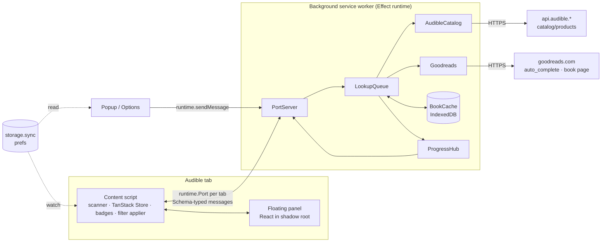

# Architecture — audible-ex

Status: design, 2026-10-29. Replaces the earlier architecture draft. Decisions are in
[DECISIONS.md](DECISIONS.md); the delivery plan is in
[PLAN.md](PLAN.md).

The behaviour we start from is the userscript in
[`reference/audible-goodreads-ratings.user.js`](../reference/audible-goodreads-ratings.user.js) (v2.4.0).
It already solves card detection, Goodreads matching, caching and badge placement, and it works
today. The extension ports that logic and adds a floating panel, progress tracking and persistent
filters. When this document and the userscript disagree about _how Audible or Goodreads behave_,
the userscript is the tested reference.

## 1. Goals and non-goals

Goals

- Goodreads rating, rating count, first-published year, top genres and an overview on hover, on
  every Audible card (search, category, deals, home daily deal, library, collections, wish list).
- A floating panel on Audible pages: progress of the Goodreads loader, filter controls, show/hide.
- Filters that reflect personal preference and persist: minimum rating (default 4.0), minimum
  number of ratings, hidden labels, later price and year.
- All 10 Audible marketplaces the userscript supports (`.co.uk .com .ca .com.au .de .fr .it .es
.in .co.jp`). Matching quality is best for English titles; other languages are best effort.
- Publishable on the Chrome Web Store (see §11). Firefox is a later target; WXT keeps that cheap.

Non-goals (for now)

- No server of our own, no accounts, no analytics. Everything runs in the user's browser.
- No bundled or exported rating dataset.
- No other rating sources in v1 (Hardcover is the planned second source, see PLAN.md).

## 2. Stack

| Tool                                       | Role                                                                                                                                                   | Notes                                                                                                                                                                     |
| ------------------------------------------ | ------------------------------------------------------------------------------------------------------------------------------------------------------ | ------------------------------------------------------------------------------------------------------------------------------------------------------------------------- |
| **Bun** 1.4                                | Package manager, script runner, test runner (`bun test`)                                                                                               | WXT 0.21 declares `bun >= 1.2`; `bun --bun wxt build` was verified to build on the Bun runtime. Bun runs package scripts by name, so `bun check` runs the `check` script. |
| **WXT** 0.21                               | Extension framework: manifest generation, entrypoints, HMR, zip/publish, `storage`, shadow-root UI                                                     | Configured with `imports: false` (no auto-imports) so the same modules load under `bun test`.                                                                             |
| **Vite** 8                                 | Bundler, through WXT                                                                                                                                   | No separate Vite config; plugins (React, Tailwind) go through `wxt.config.ts`.                                                                                            |
| **Effect** 4.1                             | Background worker: services and layers, HTTP client, schemas, concurrency, retries/backoff, request batching, typed errors. Schemas shared everywhere. | The content script uses only `effect/Schema` (see §6 on bundle size).                                                                                                     |
| **TanStack Store**                         | UI-facing state in the content script (books, progress, filter verdicts), read from React with `@tanstack/react-store`                                 | Framework-agnostic, so the non-React parts (badges, filter applier) subscribe to it too.                                                                                  |
| **TanStack Pacer**                         | UI-side timing: debounce the rating slider                                                                                                             | Background rate limiting stays in Effect so it shares the retry/backoff model. The MutationObserver batching is a plain 300 ms timer (§6), so Pacer stays out of the badge code every Audible page loads. |
| **TanStack Form**                          | Options page settings form                                                                                                                             | The floating panel's controls are live (no submit), so they don't use Form.                                                                                               |
| **TanStack Table + Virtual**               | Options page cache inspector (phase 4)                                                                                                                 | Thousands of cached books, sortable.                                                                                                                                      |
| **React 19**, **Tailwind 4**, **Radix UI** | Panel, popup, options UI                                                                                                                               | TanStack has no component library; Radix (Slider, Switch, Popover, Tooltip) provides accessible primitives, styled shadcn-style.                                          |
| **TypeScript** 7                           | Type checking (`effect-tsgo tsc --noEmit`)                                                                                                             | Bun strips types but doesn't check them. `@effect/tsgo` adds Effect diagnostics to the same run (DECISIONS.md D14).                                                       |
| **Biome**                                  | Lint and format (`biome ci`)                                                                                                                           | Replaces ESLint + Prettier (DECISIONS.md D4); its `noRestrictedImports` rule enforces the Effect import rule (§6).                                                        |
| **Playwright**                             | End-to-end smoke tests with the built extension loaded                                                                                                 | Already a dependency.                                                                                                                                                     |

Removed from the current scaffold, and why:

| Removed                                        | Replaced by                                        | Reason                                                                                                                                                                     |
| ---------------------------------------------- | -------------------------------------------------- | -------------------------------------------------------------------------------------------------------------------------------------------------------------------------- |
| Vitest, `@vitest/*`, jsdom, `vitest.config.ts` | `bun test` + happy-dom + WXT's fake browser        | Verified: `wxt/utils/storage` on `wxt/testing/fake-browser`, happy-dom DOM tests and Effect's `TestClock` all run under `bun test`.                                        |
| Zustand stores (`src/stores/*`)                | WXT `storage` items + TanStack Store               | The stores persisted to `localStorage`, which in a content script is the Audible site's own storage: per region, wiped with site data, unreadable by popup and background. |
| TanStack Query (`src/lib/query-client.ts`)     | Effect in the background, push updates over a port | Data is pushed by the background as it arrives; fetching, deduping, caching and retrying happen in Effect. A second cache layer in the UI would duplicate that.            |
| `DomainDetector` singleton                     | Pure `regionFromHost()` + a config table           | Nothing to cache or instantiate; easier to test.                                                                                                                           |
| ESLint, Prettier and their configs             | Biome                                              | One faster tool, as in the owner's other repositories (DECISIONS.md D4).                                                                                                   |
| `package-lock.json`                            | `bun.lock`                                         |                                                                                                                                                                            |

Considered and not used yet: TanStack Router (options page has a few tabs, not routes), TanStack DB,
Effect `Atom` (overlaps with TanStack Store), Effect RPC (a typed-message protocol over a port is
enough for now; revisit if the protocol grows streaming requests).

## 3. Runtime topology



- **Background** owns all network access and the cache. One queue serves every tab, so two open
  Audible tabs don't double the Goodreads traffic (the userscript ran one queue per tab).
- **Content script** finds cards, asks for the ASINs that scroll into view, renders badges, applies
  filters and mounts the panel.
- **Popup / options** read prefs from storage and ask the background for cache stats and clearing.

## 4. Background worker (Effect)

The worker builds one `ManagedRuntime` from the layer graph at start-up and runs the port server
on it. Each service is a `Context` service with a live layer and a test layer.

| Service          | Responsibility                                                                                                                                                                                                                                                                                                                    | Ported from (userscript)                                   |
| ---------------- | --------------------------------------------------------------------------------------------------------------------------------------------------------------------------------------------------------------------------------------------------------------------------------------------------------------------------------- | ---------------------------------------------------------- |
| `Http`           | `FetchHttpClient` layer. `httpGet.ts` makes every GET: `credentials: 'omit'` on each request (to Goodreads and Audible alike), so lookups aren't tied to the user's accounts; a 15 s limit; the status mapped to the errors below.                                                                                                                                                                                                  | `get()`                                                    |
| `AudibleCatalog` | `lookup(region, asin)`: `title`, first `author` (and later price) for an ASIN, from the API host of the page's marketplace. Uses `Request`/`RequestResolver` (120 ms window, grouped by host, repeated ASINs merged) so concurrent lookups batch into one `catalog/products?asins=…` call of up to 40.                                                                                                                                                         | `getMeta`, `flushMeta`                                     |
| `Goodreads`      | `search(meta)` via `book/auto_complete` (title only first, title and author when `needsAuthorSearch`) and the scoring rules, answering `Option<Match>`; `details(bookId)` from the book page's `__NEXT_DATA__` (genres, overview as text capped at 600 characters, first-published year). Responses are decoded with Schemas; a decode failure is a `FormatChanged` error, not a miss.                                                                      | `searchGoodreads`, `fetchDetails`                          |
| `BookCache`      | IndexedDB stores `ratings` (by ASIN), `meta` (by ASIN), `details` (by Goodreads id), `pins` (ASIN → last seen) and `housekeeping` (last purge); layout in §8. Time limits: found 30 days, miss 7 days; failures are never stored. A fibre purges unpinned entries older than 32 days daily; pins expire 180 days after last seen in Library/Wish List. | `cacheGet/Set`, `pin`, `purge`                             |
| `LookupQueue`    | The one place a book is looked up, for every tab: cache, then Audible metadata, then the Goodreads search; details for a found book. Dedupes in-flight work per ASIN and per Goodreads id (the shared work runs in the layer's scope, so one tab leaving cancels nothing another waits for). Every Goodreads request is a job for 3 workers, each holding 250 ms after a job; ratings run before details. A `RateLimited` pauses all workers with exponential backoff (5 s → 2 min, raised to `Retry-After`, capped at 5 min) and the job runs again after the pause, up to 3 times. A circuit breaker opens after 5 failures in a row; see below. | `grQueued`, `pumpGr`, `ratingFor`, `detailsFor`, `addYear` |
| `ProgressHub`    | `track(publish)` for one tab's port session: the session reports when a lookup begins and how its rating ended, and the hub turns that, with the queue's running searches and pause, into the tab's counters (`src/core/progress.ts`) and calls `publish` when they change, at most every 100 ms; a tab with lookups pending also looks every 500 ms. Nothing is sent for a tab that has asked for nothing. | — (new)                                                    |
| `PortServer`     | Accepts `runtime.connect` from content scripts, decodes messages, routes to the queue, encodes updates back. (One-off popup messages arrive with the popup, phase 1.)                                                                                                                                                                                      | — (new)                                                    |

Pure logic stays outside Effect, in `src/core/` (title normalisation, author/title scoring, filter
verdicts, region table). The services call it; tests hit it directly with fixtures.

Errors are tagged (`src/background/errors.ts`, `CacheError` in `BookCache.ts`): `CacheError(operation)` (IndexedDB failed),
`HttpError(status)` (`status` 0 when there was no response: network down or the 15 s limit), `RateLimited(retryAfter)`, `FormatChanged(source)`,
`NoMetadata(asin)`, and `CircuitOpen(lastFailure, reopensAt)` from the queue's breaker. `RateLimited` is `429`, `503` and the `202`/empty book page below, with `Retry-After` when sent; every other
non-`2xx` status is an `HttpError`. "Not found on Goodreads" is a normal result (`Option.none` from `Goodreads.search`, stored as a `Miss` record), cached for 7
days. Failures are not cached; the content script can retry them. `FormatChanged` is reported
separately in the panel ("Goodreads changed its page format — the extension needs an update") so it
isn't confused with network trouble.

Two behaviours found in the phase 0 spike (issue #18). Goodreads answered a book-page request
once with `202` and an empty body, which looks like a bot or rate challenge; treat `202` and an
empty body as a rate-limit signal that pauses the queue like `429`, not as `FormatChanged`. `Goodreads` fails with
`RateLimited` for both, on the autocomplete as on the book page; a page that has no `__NEXT_DATA__` script, or whose JSON does not decode, is `FormatChanged`.
The overview's HTML is turned into text by `src/core/html.ts`, since a service worker has no `DOMParser`.
`catalog/products` answers `200` with a bare `{ "asin": … }` for an ASIN the marketplace doesn't
carry (an ASIN from `.com` queried on `.ca` has no title), so `AudibleCatalog` queries the API host
of the page's own marketplace and maps a product without a title to `NoMetadata`.

**Backoff and breaker.** Constants are in `src/core/backoff.ts` and `src/core/breaker.ts`; the queue owns the clock and the state.

- The first `RateLimited` pauses every worker for 5 s, each further one in a row doubles it up to 2 min, and a success starts again at 5 s. A longer `Retry-After` raises the pause to what it asks, but never past 5 min, so a hostile header cannot stall every tab for an hour. Requests that were already in flight when a pause began, and are limited too, count as the same incident: one step of backoff, one failure for the breaker.
- A job that is rate-limited waits out the pause and runs again, at most 3 times; the fourth `RateLimited` fails it (not cached; the content script can retry).
- The breaker counts failures in a row (`HttpError`, `FormatChanged`, and each rate-limit incident) from Goodreads traffic only; Audible catalogue errors and `NoMetadata` do not count. At 5 it opens for 5 min. While open, a job that reaches the queue, queued or new, fails at once with `CircuitOpen` (no request, no wait), which the port server reports with the reason of the failure that tripped it. After the cooldown one job goes through as a probe and the others wait for its verdict: a success closes the breaker, a failure opens it for another 5 min.

**Service worker lifetime.** MV3 stops an idle worker after ~30 s. An open port with traffic keeps it
alive while a page is loading. If the worker restarts anyway, in-flight work is lost; the content
script reconnects (port `onDisconnect`) and re-sends every ASIN that has had no answer yet (`queued` or
`loading`). A book that has its rating is answered even if its details never came: a failed details
read is not cached, so asking again on each reconnect would fetch the book page in a loop; the details
come with the next page load. The cache
makes that cheap. The wait before a reconnect starts at 100 ms and doubles to 30 s, starting
again after a connection that held, so a worker that never comes back is not asked in a loop. With
nothing unresolved the content script does not reconnect until the next lookup: reconnecting only
to be stopped again would keep the worker running for as long as a tab is open. Verified in the spike: after the worker was stopped, the port disconnected, the
content script's `onDisconnect` reconnect reached a new `ManagedRuntime` within 100 ms, and it
answered the re-sent `Hello`. Not yet verified: the natural ~30 s idle stop (a debugger attached
through CDP keeps the worker alive), so check it in a normal browser in phase 1.

## 5. Messaging

One long-lived `runtime.Port` per tab, named `agx`. Every message is an Effect Schema tagged union
(`_tag`), decoded on receipt in both directions. The schemas are in `src/schema/messages.ts`; they
share identifiers and the rating and details shapes with the cache records
(`src/schema/common.ts`, `cache.ts`).

Content → background

| Message  | Fields                                                                                                    |
| -------- | --------------------------------------------------------------------------------------------------------- |
| `Hello`  | `region` (a `RegionCode`), `page` (`home`, `search`, `category`, `deals`, `library`, `wishlist`, `other`) |
| `Lookup` | `items: { asin, pinned }[]` — `pinned` on library/wish list rows                                          |
| `Retry`  | `asins`                                                                                                   |

Background → content

| Message      | Fields                                                                                                                                                                                                                                              |
| ------------ | --------------------------------------------------------------------------------------------------------------------------------------------------------------------------------------------------------------------------------------------------- |
| `BookUpdate` | `asin`, `status` (`loading`, `ready`, `notFound`, `failed`), `rating?` (`{ r, n, url, loose }`), `details?` (`{ genres, year, desc }`), `error?` (`{ reason, message }`, `reason` one of `httpError`, `rateLimited`, `formatChanged`, `noMetadata`) |
| `Progress`   | `queued`, `active`, `done`, `cached`, `notFound`, `failed` (counters of this tab) and `pausedUntil?` (epoch milliseconds)                                                                                                                           |

`PortServer` serves each port in its own session. `Hello` records the tab's region, which `Lookup` and `Retry` need; a `Lookup` before `Hello` is dropped and logged. A message that does not decode is dropped and logged as a warning; the port stays open. For each ASIN the server sends `loading` when the cache did not have it, then `ready` with the rating, then `ready` again with the details; a cached book with its details is one `ready` and no `loading`. A book that is not on Goodreads is `notFound`; any lookup failure is `failed` with its reason. If only the details fail, the `ready` with the rating stands. An ASIN already being looked up for the same port is not started twice, so a repeated `Hello` or `Lookup` (the content script re-sending the ASINs that had no answer after a reconnect) is harmless; `Retry` is a lookup again, since failures are not cached. When the port disconnects, only the session's waiting fibres end; lookups other tabs share carry on. The worker buffers a port's early messages (`buffered` in `src/background/port.ts`) because the runtime opens IndexedDB after `onConnect` fires. The server sees the port through the small `PortLike` interface, so tests use a fake. The session reports each lookup to the `ProgressHub`, whose publisher sends the tab a `Progress` when its counters change. `done` counts every ASIN whose rating is settled, so the bar is `done / (done + queued + active)`; `cached`, `notFound` and `failed` are counted inside `done` and may overlap (a miss answered from the cache is both `cached` and `notFound`); of the ASINs still pending, `active` have a Goodreads search running (`LookupQueue.running`) and `queued` are the rest, waiting for the catalogue, a worker or a pause. A `Retry` takes the ASIN's earlier outcome back until it settles again. `pausedUntil` is set only while something is pending.

`BookUpdate` carries what its `status` implies: `ready` has `rating` (and `details` once the book page has been read), `failed` has `error`, `loading` and `notFound` have neither. The `queued` status of §6's `BookView` exists in the content script's store only; the background never sends it.

Popup / options → background (one-off `sendMessage`, schemas in `src/schema/popup.ts`):
`CacheStats`, answered with `Stats { books, entries, bytes, pinned }`, and
`ClearCache { scope: 'unpinned' | 'all' }`, answered with `Cleared { deleted }`; a cache that cannot
be read or cleared is answered `Failed { message }`. These replace the userscript's
`GM_registerMenuCommand` entries. `src/background/popup.ts` answers them from the same `BookCache`
the port server uses (`liveLayer` builds it once and offers it next to `PortServer`). A message
that does not decode is left unanswered, and one whose `sender.url` is not one of the extension's
own pages (`runtime.getURL('/')`) is ignored: a content script's sender URL is the web page's, so a
page cannot make the extension empty its cache. The URL decides rather than the absence of
`sender.tab`, because extension pages opened in a tab (the options page, the popup in a test) have
one too.

## 6. Content script

```
scan (MutationObserver, batched in 300 ms)
  → card + ASIN (ported cardFor / asinOf / findTitleEl)
  → IntersectionObserver (400 px margin)
  → Lookup over the port
BookUpdate → book store (books) → badges + filter applier + panel
```

**Scanner and cards.** Ported as-is: card detection by "largest ancestor linking only to this
ASIN", known row selectors for library and list pages, observer cleanup. Cards are DOM elements, so
they stay out of the reactive store: a `WeakMap<Element, asin>` (the scanner's) and a
`Map<asin, Set<Element>>` (redraws every card of a book; pruned of removed cards after each scan).

The port does not carry a book's title, which the userscript used to pick the title element, so the
title comes from the card: the text of a link to the ASIN inside a heading, else the first text link,
else (cards linked from the cover only) the cover's `alt` text. The element search itself is the
userscript's. On the saved pages this places every badge where the userscript did
(`src/content/fixtures.test.ts` compares each card with a copy of the userscript's code).

**Book store (TanStack Store).** `src/content/books.ts` holds the tab's state in a TanStack `Store`
(`BookStore.state`) and keeps the small interface the DOM code uses: `get`, `set`, `entries` and
`subscribe`, whose listener hears which book changed. The panel reads `state` with selectors
(`useStore`); the badges and the hover overview do not need React or a selector, and redrawing one
book's cards when one book changes is cheaper than diffing the page. Each change replaces the
`books` map, so a selector sees a new value; the background's `Progress` goes in through
`setProgress` and does not call the per-book listeners. `prefs` and `peek` join the state in
phase 3.

```ts
type BookView = {
  status: 'queued' | 'loading' | 'ready' | 'notFound' | 'failed'
  rating?: { r: number; n: number; url: string; loose: boolean }
  details?: { genres: string[]; year: number; desc: string }
  price?: { amount: number; currency: string }
}
type ContentState = {
  books: ReadonlyMap<string, BookView>
  progress: Progress | undefined // until the background has sent any
  prefs: Prefs // phase 3
  peek: boolean // phase 3
}
```

**Badges.** Plain DOM, not React. Badges must sit inside Audible's own markup, there can be
hundreds, and the userscript's placement code already handles Audible's layouts. Classes use an
`agx-` prefix; the small stylesheet is imported as a string (`?inline`) and injected once.

**Filter applier.** A derived store computes a verdict per ASIN, `show | dim | hide`, from
`books` and `prefs` (§7). A subscriber writes it to `data-agx-filter` on each card, and CSS does the
rest (`[data-agx-filter=hide]{display:none!important}`). Removing a filter only removes an
attribute; nothing is torn down and rebuilt.

**Hover overview.** `src/content/overview.ts`, plain DOM: one `mouseover`/`mouseout` listener pair
on the document finds the badge (its `data-asin` names the book, read from the store when the
pointer arrives, so a year that came later shows), and a capturing `scroll` listener hides the box.
The box is `position: fixed` inside a shadow root on an `agx-overview-host` element (ignored by the
scanner), so Audible's CSS can't reach it. The host and its root are made by hand for now; the
panel will take over the same root.

**Floating panel.** A second content script, `src/entrypoints/panel.content/` (DECISIONS.md D19), so
React stays out of `content.js`. It draws React in a shadow root made by WXT's `createShadowRootUi`
(host element `agx-panel`), so Tailwind and Audible's CSS can't affect each other. Its stylesheet is
imported as text (`?inline`) and passed as the `css` option; `cssInjectionMode: 'ui'` would make WXT
fetch the file from an extension URL and so list it in `web_accessible_resources`, which the manifest
does not have. The hover overview keeps its own shadow root (`agx-overview-host`) in `content.js`.

The two scripts share one isolated world, and meet through `src/content/shared.ts`: `content.js`
publishes a `PanelHandle` (the book store's `state`, and `retryFailed()`) on `globalThis` and fires an
`agx:panel-handle` event on the document; the panel script reads it with `watchHandle`, mounts when
there is a handle and unmounts when it is withdrawn (the extension was switched off), through
`runPanel` (`src/panel/host.ts`). There is one port per tab, and it is the badge script's. The panel
shows nothing until the tab has asked for a book. `bun e2e` checks on live Audible that the panel's
progress bar appears, which is the one thing `bun test` cannot prove about the shared world.

- Shell: drag to a corner, collapse to a pill (`34/60`), hide for this site. The state is the
  `local:panel` item (§8). Dragging follows the pointer and, on release, docks to the viewport corner
  nearest the panel's centre (`src/panel/drag.ts`); a press that moves under 4 px is a click. The
  panel draws nothing until it has read the item, so it never flashes at the wrong corner. "Hide on
  this site" adds the host name to `hiddenHosts`; the popup shows "Show the panel again" while any
  host is hidden and clears the list, and the panel, which watches the item, reappears at once.
  Affordances: the title is a grip (six dots, grab cursor, hover highlight) and, while dragging,
  four dashed markers show the corners with the nearest one lit. The extension's logo (the small
  variant, bundled as text with `?raw` and passed in as a data URL, so no web-accessible resource)
  marks the pill and the header, where it links to the project page; opening the popup from the page
  would need a message to the background (`action.openPopup`) and is not done.
- Two levels of lookups: the ratings bar is the background's `Progress` counters. The second bar
  ("Genres, year & overview") is derived in the content store: of the books that are `ready` with a
  rating, how many have `details` (`detailsProgress`, `src/panel/summary.ts`), because the queue reads
  a book's Goodreads page after every rating. A book whose page could not be read keeps its rating and
  never gets details, so the bar can stop short of full; the store cannot tell that from waiting. Once
  every rating is in, the collapsed pill shows `details 12/34` instead of `60/60`.
- Progress: bar plus `34/60 · 18 cached · 2 not found · 1 failed`; "Paused — Goodreads is rate
  limiting (12 s)"; "Retry failed".
- Filters (`src/panel/Filters.tsx`, built, below the progress): the master switch and `12 hidden ·
  Show` always; a "Filter settings" area opens the rating slider (3.0–5.0, step 0.1), the minimum
  number of ratings, the hidden labels, and the two policies. A change shows at once and is saved
  300 ms after the user stops (Pacer's debouncer, flushed if the panel goes away), through
  `updateFilters`, whose writes run in order. The label picker suggests the genres the page's books
  carry, most common first (`genres.ts`), not genres from the whole cache.
- Counter: `12 hidden · Show` — **Show** toggles `peek`, which reveals hidden cards (dimmed)
  without changing preferences.

**Effect in the content script.** Only `effect/Schema`, for the message codecs. The content script
runs on every Audible page, so it stays lean; the concurrency and error handling Effect is good at
live in the background. Import Effect modules by path (`effect/Schema`), never from the `effect`
barrel: measured with Bun's bundler, a Schema-only module was 23 KB gzipped via `effect/Schema` and
97 KB via `effect`. A Biome rule enforces this in the content script, the UI and the modules they
share (`src/schema`, `src/storage`).

## 7. Filters

Verdict for one card (pure function in `src/core/filter.ts`):

1. Filters off → `show`.
2. Book not loaded yet (`queued`/`loading`/`failed`) → `show`. Hiding before data arrives makes the
   page jump.
3. `notFound` → the `notFound` policy (default `show`).
4. Rating below `minRating`, or count below `minRatings`, or any genre in `hiddenLabels`
   (case-insensitive) → the miss mode (`hide` by default, `dim` as an option).
5. Price above `maxPrice[region]` (phase 3b) → the miss mode.
6. Otherwise `show`.

Two adjustments follow the verdict: a card inside a carousel gets `dim` for `hide`, and so does every
card while `peek` is on (the `12 hidden · Show` counter reveals the hidden books, dimmed, without
touching the filters). `judge` gives the verdict before the adjustments and is what the counter
counts; `place` applies them; `verdict` is both (`src/core/filter.ts`, inputs are structural so the
module needs nothing from the content script or storage). A rating filter acts as soon as the rating
arrives; a hidden-label filter acts once the details have.

Cards inside carousels get `dim` instead of `hide`; removing slides breaks Audible's carousel
layout. From the saved pages, a carousel is `adbl-product-carousel`, `adbl-product-featured-carousel`
(the US home page's featured row), a not yet loaded `.adbl-carousel`, or anything with
`aria-roledescription="carousel"` (`CAROUSEL` in `src/content/cards.ts`). Search results, deals and
the library's own rows are in none; the search, category and home pages mix both kinds.

The applier (`src/content/filter.ts`) sets `data-agx-filter="hide|dim"` on each card and counts the
hidden ones. Everything that can change a verdict (a book arriving, a card being attached, the
settings, peeking) ends in one pass over the page's cards, which is a few hundred. The settings come
from `sync:prefs` through a watcher, so every open tab applies a change at once. Until the settings
have been read nothing is filtered. The panel reads `hidden` and `peek` from the `PanelHandle` and
calls `setPeek`.

Label filtering needs genres, which come from the Goodreads book page (~400 KB), not the cheap
autocomplete call. Details are fetched for every visible book by default (they also drive the labels
under each badge), at lower priority than ratings. Until a book's details arrive, a hidden-label
filter can't apply to it and the card stays visible.

## 8. State and persistence

| Data                                                   | Where                                                                              | Why                                                                                                |
| ------------------------------------------------------ | ---------------------------------------------------------------------------------- | -------------------------------------------------------------------------------------------------- |
| Preferences: enabled, filters, display options         | `storage.sync` via WXT `storage.defineItem('sync:prefs', { version, migrations })` | Personal preference; follows the user across devices and Audible regions. Well within sync quotas. |
| Panel placement, collapsed state, hidden-on-site flags | `storage.local`                                                                    | Specific to this screen and device.                                                                |
| Cache: ratings, meta, details, pins, housekeeping      | IndexedDB in the background, through `idb` (DECISIONS.md D13)                      | Thousands of records; needs an index on timestamp for purging. `unlimitedStorage` permission.      |
| Peek, progress, book views                             | Memory (TanStack Store)                                                            | Per page.                                                                                          |

Every reader (content scripts, popup, options) watches `sync:prefs`, so a change in one tab applies
everywhere at once. Prefs are decoded with an Effect Schema that supplies defaults, so a missing or
older field never crashes the UI.

The panel's own state (`src/storage/panel.ts`: `corner`, `collapsed`, `hiddenHosts`) is the
`local:panel` item, version 1, decoded with defaults like the prefs.

`src/storage/prefs.ts` holds `enabled` (the popup's master switch) and `filters`, version 2; the
display options arrive with the options page (phase 4) and `maxPrice` in phase 3b, each with a
default, so neither needs more than a version bump. WXT runs the version 1 → 2 migration when the
module loads (it was `enabled` alone; the migrated record has the filters at their defaults). The
content script runs only while the extension is on (`src/content/lifecycle.ts`): turning it off
removes the badges, the overview and the stylesheet and closes the port, which ends this tab's
lookups; turning it on starts the script again.

```ts
// Prefs v2, defaults shown
{
  enabled: true,
  filters: {
    enabled: true,
    minRating: 4.0,          // slider 3.0–5.0, step 0.1
    minRatings: 50,          // 0 turns it off
    hiddenLabels: [],        // Goodreads genre names
    notFound: 'show',        // 'show' | 'dim' | 'hide'
    mode: 'hide',            // 'hide' | 'dim'
    maxPrice: {},            // per region, phase 3b
  },
  display: { labels: 3, year: true, overview: true },
}
```

The cache is keyed by ASIN and by Goodreads book id, not by region: ASINs are unique across
marketplaces, and the same Goodreads book seen from two regions shares one details entry. The
same title can have a different ASIN on each marketplace (Project Hail Mary is `B08G9PRS1K` on
`.com` and `B08GBHW6J1` on `.ca`), so a book seen on two marketplaces is two `ratings` entries
that share one `details` entry.

Cache database `audible-ex-cache`, version 1. Object stores and keys: `ratings` and `meta` by
`asin`, `details` by `bookId`, `pins` by `asin`, each with an index on `savedAt` (`pins`:
`lastSeen`) that the purge walks oldest first; `housekeeping` by `name`, holding one record,
`lastPurge`, so the once-a-day gate survives a worker restart. Every record read is decoded with
its Schema (`src/schema/cache.ts`); one that fails to decode is deleted and read as absent. The
service opens the database from the `IDBFactory` it is given (`self.indexedDB` in the worker).
Pinned means: for `ratings` and `meta`, the ASIN has a live pin; for `details`, the book id is the
`bookId` of a found rating of a pinned ASIN. The purge, and `clear`, run in one readwrite
transaction over all stores. `clear('all')` deletes every entry and every pin (the userscript's
"everything" left its pin list); it leaves `housekeeping`. `stats` counts entries (ratings, meta,
details) and pins separately and sizes everything as the JSON of its records.

## 9. Regions

`src/core/regions.ts` maps hostname → region code, Audible API host (`www.` → `api.`), currency and
locale. The 10 marketplaces match the userscript's `@match` list. The content script's `matches` and
the manifest's host permissions are generated from the same table, so they can't drift apart.

Price, when added, comes from the Audible catalog API rather than from page text. Whether
`catalog/products` returns price without signing in (via a price response group) is unverified; it
is the first task of phase 3b, with page-text parsing as the fallback.

## 10. Testing

| Layer               | Tool                                           | What                                                                                                                                   |
| ------------------- | ---------------------------------------------- | -------------------------------------------------------------------------------------------------------------------------------------- |
| Pure logic          | `bun test`                                     | Matching (with real autocomplete fixtures), filter verdicts, region table, Schemas.                                                    |
| Background services | `bun test` + test layers                       | Fake `HttpClient` returning recorded fixtures; `TestClock` for cache expiry, backoff and the request gap; queue dedupe and priorities. |
| Content script DOM  | `bun test` + happy-dom                         | Card detection and badge placement against saved Audible page HTML for each page type.                                                 |
| React UI            | `bun test` + Testing Library                   | Panel states, filter controls, peek.                                                                                                   |
| Storage             | `bun test` + `wxt/testing/fake-browser`        | Prefs defaults, migrations, watch.                                                                                                     |
| End to end          | Playwright, built extension loaded in Chromium | Smoke test on live Audible pages; run manually and before releases, not on every push (live sites change).                             |

`test/preload.ts` (set in `bunfig.toml`) registers happy-dom and `fake-indexeddb` (DECISIONS.md
D15; each `BookCache` test still gets its own `IDBFactory`, so a restart test reopens the
same database) and sets `globalThis.browser` and
`chrome` to WXT's fake browser. `@wxt-dev/storage` reads `browser` from `@wxt-dev/browser`, so mocking
only `wxt/browser` isn't enough; the global is what works (verified).

Fixtures live in `test/fixtures/{audible,goodreads}/` and are refreshed with
`bun scripts/capture-fixtures.ts` when a site changes. A failing fixture test after refreshing is
how we detect that Audible or Goodreads changed their pages. The script goes through the same
courtesy rules as the extension (one request at a time, a pause, no cookies, back off on 429/503 and then stop) and
never runs in CI. Pages are stored cleaned: no scripts, tokens, request ids, session values or
reviewer data. Library and wish list need a signed-in browser, so they are saved by hand and cleaned
by `capture-fixtures.ts import`. What each fixture is, and the steps, are in
`test/fixtures/README.md`.

## 11. Manifest, permissions, privacy

- `permissions`: `storage`, `unlimitedStorage`.
- `host_permissions`: `https://www.goodreads.com/*` and the 10 `https://api.audible.<tld>/*` hosts.
  Background fetches need these to get past CORS.
- Content script `matches`: the 10 `https://www.audible.<tld>/*` sites; `all_frames: false`.
- No `tabs`, `scripting` or `<all_urls>`. The port's `sender.tab.id` identifies the tab.
- No remote code; everything is bundled.

Privacy. The extension reads Audible page content, including Library and Wish List, and sends book
titles and authors to Goodreads to look up ratings. The ASINs of the books on the page go to Audible's own catalogue API
(`api.audible.<tld>`, the marketplace being browsed) to get each book's title and author. Nothing else leaves the browser: no
analytics, no server, no account. No request to Goodreads or Audible carries cookies. The store listing's privacy disclosures and the privacy policy say exactly that.

Publishing constraints that shape the code:

- Every badge links to the Goodreads page it came from.
- The overview is capped at 600 characters, kept only as long as the cache entry, and never
  exported.
- Name and icons don't use Audible, Amazon or Goodreads logos or trade dress. The listing and the
  popup (the options page too, once it exists) carry "Not affiliated with Audible, Amazon or
  Goodreads." The popup links to the privacy policy, `PRIVACY.md`; the listing's text and answers
  are in `docs/STORE-LISTING.md`.
- Conservative request rate and caching, as in §4.

## 12. Project layout

WXT `srcDir: 'src'`, so entrypoints live under `src/entrypoints` and the `@/` alias means `src/`.

```
src/
  entrypoints/
    background.ts            # builds the ManagedRuntime, starts PortServer
    content/index.ts         # scanner, store, badges, filter applier; publishes the panel handle (no React)
    panel.content/index.tsx  # the floating panel: its own content script, React in a shadow root
    popup/                   # enable toggle, show panel, cache stats/clear
    options/                 # settings (TanStack Form), cache inspector (Table + Virtual)
  core/                      # pure TS, no DOM, no Effect: text.ts, matching.ts, filter.ts, regions.ts, asin.ts, page.ts,
                             #   expiry.ts (cache time limits and pin rules), html.ts, retryAfter.ts
  schema/                    # Effect Schemas: messages.ts, prefs.ts, goodreads.ts, audible.ts, cache.ts
  background/                # Effect services: Goodreads.ts, AudibleCatalog.ts (with errors.ts, httpGet.ts), BookCache.ts,
                             #   BookCacheTest.ts (test layer over fake-indexeddb), HttpTest.ts (fake fetch for the network services' tests), LookupQueue.ts, ProgressHub.ts, PortServer.ts, layers.ts
  content/                   # main.ts (wires the parts below), scanner.ts, cards.ts, badges.ts, badges.css,
                             #   books.ts (the book store, a TanStack Store), shared.ts (the handle the panel reads),
                             #   port-client.ts, schedule.ts; filter-applier.ts arrives with the filters
  panel/                     # React, for the panel script only: Panel.tsx, host.ts (mounts it while the badge script
                             #   has a handle), summary.ts (what to show for the counters), panel.css (Tailwind, as text)
  ui/                        # React components shared with the popup and options page (Radix-based), hooks/
  storage/                   # WXT storage item definitions
  assets/                    # brand/ logo sources; icon.png (Conductor's repository icon)
  public/                    # icon/ PNGs, copied into the build as-is
test/
  preload.ts
  fixtures/{audible,goodreads}/
scripts/
  capture-fixtures.ts
reference/
  audible-goodreads-ratings.user.js
```

## 13. Commands

| Command         | Runs                                                                    |
| --------------- | ----------------------------------------------------------------------- |
| `bun install`   | Install; `postinstall` runs `wxt prepare`                               |
| `bun dev`       | `wxt` (Chrome, hot reload); `bun dev:firefox` for Firefox               |
| `bun run build` | `wxt build` (`bun build` is Bun's own bundler, so this one needs `run`) |
| `bun zip`       | `wxt zip`, the store upload                                             |
| `bun test`      | Unit and component tests                                                |
| `bun typecheck` | `wxt prepare && effect-tsgo tsc --noEmit`                              |
| `bun check`     | `biome ci` → `bun typecheck` → `bun test`; what CI runs                 |
| `bun e2e`       | Playwright smoke test against a fresh build                             |

Bun and Node versions are pinned in `mise.toml` (Node stays as a fallback runtime for WXT/Vite); CI
installs from the same file with `jdx/mise-action`. CI's shape is in PLAN.md, phase 0.
